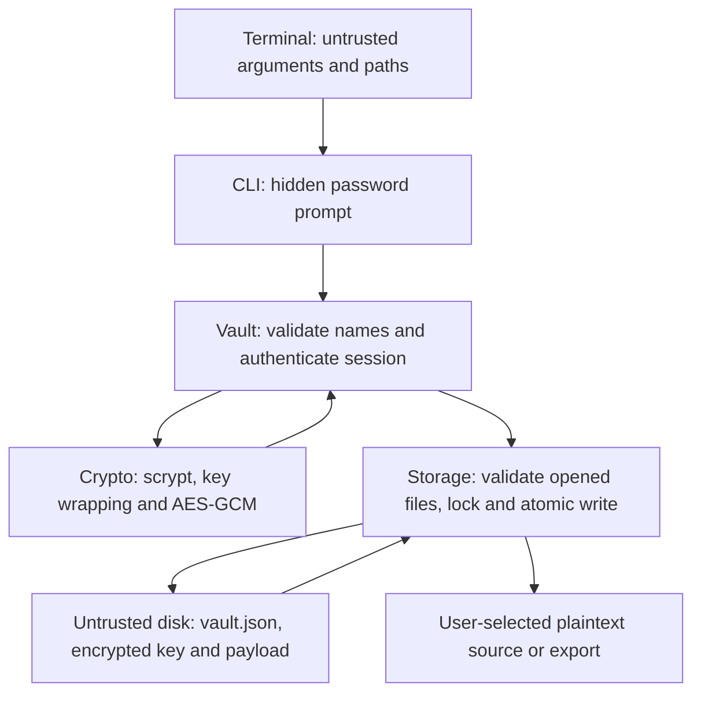

# Checkpoint 2 design

Python 3.11+ provides memory-safe application code and Linux file APIs.
PyCryptodome 3.23.0 provides AES-GCM, scrypt, HKDF and OS-backed randomness.
The original checkpoint 1 documents are in `checkpoint1/`; this document describes
the implemented format and supersedes their future implementation claims.

## Architecture and data flow

Trust boundaries are terminal → application and application → disk. The process
contains plaintext and keys only during a command; its memory is outside the
protection offered against a compromised running machine. Keys are never stored
unencrypted on disk. The exported destination is intentionally plaintext.

## Version 1 format

`vault.json` is a bounded JSON envelope (32 MiB maximum):

| Field | Contents |
| --- | --- |
| `header` | Version 1; scrypt N=131072, r=8, p=1; random 16-byte salt |
| `wrapped_key` | Random 32-byte master key encrypted with the password-derived key |
| `payload` | Encrypted JSON mapping logical names to base64 contents, sizes and timestamps |

Both encrypted envelopes contain base64 `nonce`, `data` and `tag`. AES-256-GCM
uses a fresh random 12-byte nonce and a 16-byte authentication tag. The canonical
header is associated data for both operations. Fixed header parameters are
checked before invoking scrypt. Successful verification of the wrapped key and
payload authenticates the password; no separate password hash is stored.

Each save generates a fresh salt, re-wraps the master key and derives a payload
key using HKDF-SHA256 with context `sfm-payload-v1`. No plaintext is returned
until GCM verification succeeds. The CLI then validates the decrypted schema.
`passwd` retains the master key; `rekey` replaces it. Both rewrite the vault.

Unlike the proposed object store, this format encrypts a single bounded payload.
It needs no object IDs, per-file keys or chunk counters. Large-file streaming and
migration from any future format are deferred. The supplied skeleton had no
existing vault format or user data to migrate.

## Threats and implemented mitigations

| Threat | Mitigation and remaining limit |
| --- | --- |
| Traversal through logical names | Reject separators, dot names, controls and excessive lengths; names never become vault paths |
| Symlink, hard-link or special-file input | `O_NOFOLLOW`, descriptor-based regular-file and link-count checks; `O_NONBLOCK` prevents waiting on FIFOs |
| Path check/use race | Check opened descriptors; temporary files use exclusive creation and directory-relative operations; ancestor directories must be trusted |
| Accidental export overwrite | Atomic no-clobber publication; explicit `--force` for replacement; reject export within vault |
| Concurrent updates or interrupted writes | Exclusive directory `flock`; private temporary file, file fsync, atomic rename, directory fsync |
| Vault read by another local account | Owner and permission checks; directory 0700, files 0600 |
| Ciphertext/header modification | AES-GCM authenticates header, key and payload; generic authentication error; no partial export |
| Oversized inputs or malicious KDF costs | 8 MiB input and 32 MiB envelope limits; fixed KDF settings; only bounded regular-file reads |
| Offline password guessing | Random salt and scrypt; 12-character minimum for new passwords; strong passphrase still required |
| Password in shell history, process arguments or output | Hidden terminal prompt only; echoing fallback rejected; no password option or logs |
| Terminal escape sequences or secrets in errors | Reject control characters in logical names; fixed OS error text; no raw exception traces |
| Keys/plaintext in memory, swap or dumps | Disable core dumps through CLI; short sessions and best-effort master bytearray overwrite; Python copies cannot be reliably erased |
| Nonce/key reuse | Cryptographic random salt/nonces; domain-separated payload key per save; random-collision risk remains negligible, not mathematically impossible |
| Corrupted/deleted disk or malicious rollback | Corruption detected, but availability and whole-vault rollback require trusted backups; no rollback detection |
| Dependency compromise | One pinned runtime dependency; updates and independent review remain necessary |

Online throttling from the original proposal is deferred: each CLI invocation is
independent and local throttling cannot prevent offline guessing. Locks coordinate
cooperating processes, not an attacker with access to an unlocked account.

Cryptographic API references:
[PyCryptodome AES](https://www.pycryptodome.org/src/cipher/aes),
[KDFs](https://www.pycryptodome.org/src/protocol/kdf).
